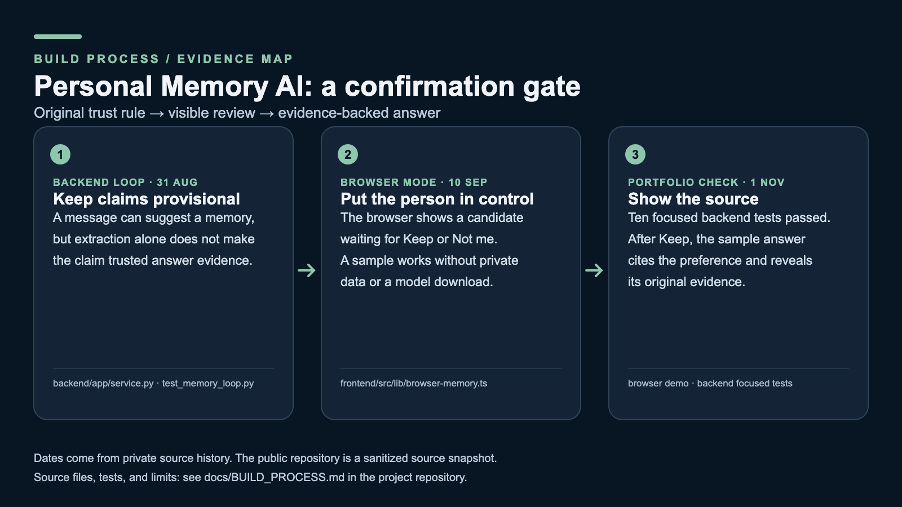

# Personal Memory AI: build process evidence

The [portfolio guide](../PORTFOLIO.md) states the product scope and credits. The dates below come from the private source history; the public repository is a sanitized export at `be977ce`, so those earlier commits are not available to browse here. This diagram is a retrospective explanation of the design, not an original dated sketch.

| Stage | Question and change | Public evidence |
| --- | --- | --- |
| Backend loop, 31 August 2026 | How can an extracted personal claim avoid becoming trusted merely because it sounds plausible? The first loop stores a candidate as unconfirmed, lets a person keep or reject it, and searches confirmed memories for answer evidence. | [Backend demonstration](../backend/demo_memory_loop.py), [service](../backend/app/service.py), [memory-loop tests](../backend/tests/test_memory_loop.py) |
| Browser-local prototype, 10 September 2026 | Make the trust boundary visible to a person without a private database or model download. The browser runtime lets a sample candidate wait for **Keep** or **Not me**. | [Browser memory runtime](../frontend/src/lib/browser-memory.ts), [review screenshot](review.png) |
| Portfolio check, 1 November 2026 | The ten focused backend tests passed. In a localhost browser run, an unconfirmed sample did not count as trusted answer evidence; after **Keep**, the answer cited the confirmed preference and exposed its original text. | [Browser instructions](../README.md#try-the-browser-prototype), [answer screenshot](answer.png), [short recording](demo.mp4) |

These checks demonstrate the core memory trust loop. They do not establish all other browser, desktop, voice, synchronization, or recipient-delivery paths.
